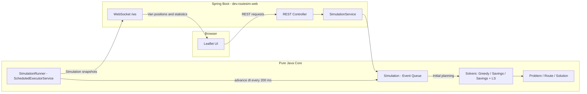

# Delivery Route Simulator

A delivery fleet optimisation and simulation application built with **Java 21**, Spring Boot, and Leaflet. It uses vehicle routing algorithms implemented from scratch — no OptaPlanner or Timefold — and replays delivery routes as a live, discrete-event simulation on an interactive map.

**Live demo:** *[Add your Render URL here]*

> **Optimisation results:** Reduces total fleet distance by approximately 15–22% compared with a greedy nearest-neighbour baseline on seeded scenarios containing 50–500 orders. On 10-order instances solved exactly, the savings-plus-local-search algorithm achieves an average optimality gap of just 2.0%.

> **CVRPLIB benchmark:** *[Add your Augerat A benchmark result here](benchmarks/cvrplib/README.md).*

*Note: The live demo runs on Render's free tier, which may sleep after 15 minutes of inactivity. The first request after sleeping can take around a minute.*

<!-- TODO: Add a demo GIF showing the Compare view. -->

## Results

### Seeded random scenarios

Results use Haversine distances in kilometres, a van capacity of 100, parcel sizes between 1 and 10, and the mean of five random seeds.

| Orders | Greedy (km) | Savings (km) | Savings + LS (km) | Savings vs. Greedy | Savings + LS vs. Greedy | Greedy (ms) | Savings (ms) | Savings + LS (ms) | Vans (Greedy / S+LS) |
|-------:|------------:|-------------:|------------------:|-------------------:|------------------------:|------------:|-------------:|-------------------:|---------------------:|
| 50    | 215.9 | 187.5 | 182.8 | -13.2% | -15.4% | 0.9 | 0.5 | 2.2 | 3.2 / 3.4 |
| 100   | 355.9 | 282.4 | 276.4 | -20.7% | -22.3% | 2.0 | 1.5 | 8.9 | 6.0 / 6.4 |
| 200   | 562.4 | 462.1 | 450.9 | -17.8% | -19.8% | 1.3 | 10.6 | 26.8 | 11.4 / 11.6 |
| 500   | 1114.8 | 911.9 | 896.1 | -18.2% | -19.6% | 5.0 | 118.0 | 177.9 | 28.0 / 28.4 |

**Benchmark notes:**

- Distances are straight-line Haversine distances, not road distances.
- Runtimes were measured on a laptop-class machine, using a single thread after JIT warm-up. Results may vary by hardware and JVM.
- Local search has a five-second time limit, which none of these runs reached.
- Savings-based algorithms may use an additional van to reduce total distance. Fleet size is not capped.

### How close to optimal?

For instances containing 10 orders, the true optimum can be calculated exactly using subset dynamic programming, implemented in `OptimalityGapTest`.

Results are averaged over 30 seeded instances with a van capacity of 30.

| Algorithm | Average distance above optimum |
|-----------|-------------------------------:|
| Greedy | +21.5% |
| Clarke–Wright Savings | +3.0% |
| Savings + Local Search | **+2.0%** |

Reproduce these results locally:

```bash
mvn test -Dtest=OptimalityGapTest
java -cp target/classes dev.routesim.bench.BenchmarkRunner
```

The test prints the optimality-gap results. Run the benchmark runner separately to evaluate larger scenarios.

## Features

- **Multiple routing algorithms:** Compare greedy nearest-neighbour, Clarke–Wright savings, and savings with local search.
- **Interactive fleet simulation:** Watch vans travel between stops on a Leaflet map.
- **Live order insertion:** Click the map to add orders while the simulation is running.
- **Route comparison:** Compare greedy and optimised solutions on the same scenario.
- **Capacity constraints:** Every route respects the configured van capacity.
- **Reproducible benchmarks:** Generate deterministic scenarios using random seeds.
- **Exact optimality evaluation:** Compare heuristic solutions against an exact solver on small instances.
- **CVRPLIB support:** Parse benchmark instances in `.vrp` format for comparison with published best-known solutions.

## Getting Started

### Prerequisites

- Java 21 or later
- Maven
- Docker (optional)

### Run locally

Start the Spring Boot application:

```bash
mvn spring-boot:run
```

Open [http://localhost:8080](http://localhost:8080) in your browser.

### Run the tests

```bash
mvn verify
```

### Run with Docker

```bash
docker build -t route-sim .
docker run -p 8080:8080 route-sim
```

### Run the benchmark

```bash
mvn -q package -DskipTests
java -cp target/classes dev.routesim.bench.BenchmarkRunner
```

### Using the application

1. Select a routing algorithm.
2. Generate or configure a delivery scenario.
3. Press **Start** to begin the simulation.
4. Click the map to add orders while vans are moving.
5. Use **Compare on this scenario** to compare greedy and optimised routes using the same orders.

New orders are inserted into the cheapest feasible route. If no existing van can accommodate an order, an idle van is activated or a new van is dispatched.

## Architecture



### Project structure

The core components are separated from the web layer:

- `model/` — routing problems, routes, and solutions.
- `solver/` — optimisation algorithms and local-search operators.
- `sim/` — discrete-event simulation and execution.
- `bench/` — benchmark runners and CVRPLIB support.
- `web/` — Spring Boot REST and WebSocket integration.

The model, solver, simulation, and benchmark layers have no Spring dependency. This allows the core algorithms to be unit-tested quickly and benchmarked without starting a server.

## Routing Algorithms

### 1. Greedy nearest neighbour

**Class:** `NearestNeighbourSolver`

Builds routes one van at a time, repeatedly selecting the nearest undelivered order that fits within the remaining capacity.

This provides a simple baseline for evaluating more advanced optimisation strategies.

### 2. Clarke–Wright savings

**Class:** `ClarkeWrightSolver`

Starts with one route per order and calculates the savings from merging pairs of routes:

\[
s(i,j) = d(0,i) + d(0,j) - d(i,j)
\]

Here, `0` represents the depot, and `i` and `j` represent delivery locations.

Routes are merged in descending order of savings when both locations are eligible route endpoints and the combined load respects vehicle capacity.

### 3. Local search

**Class:** `LocalSearch`

Improves the Clarke–Wright solution using four neighbourhood operations:

- **2-opt:** Removes inefficient edge crossings within a route.
- **Relocate:** Moves a stop within or between routes.
- **Swap:** Exchanges stops between routes.
- **2-opt\*:** Exchanges route tails between two routes.

The implementation uses a first-improvement strategy and checks capacity constraints. Accepted moves must improve the objective, so local search does not worsen the initial solution.

Together, these operators improve the quality of the savings-based solution while preserving feasibility.

## Simulation Engine

The simulation is event-driven rather than based on fixed movement ticks.

- A `PriorityQueue` stores timed events such as `DEPART` and `ARRIVE`.
- A simulation clock tracks elapsed simulated time.
- A speed multiplier controls how quickly simulated time advances.
- A `ScheduledExecutorService` advances the simulation every 200 milliseconds.
- Simulation snapshots are sent to the browser over WebSocket.

Because the engine advances between scheduled events, it avoids unnecessary work while vans are travelling. Its deterministic clock also makes it possible to test simulation behaviour without relying on real-time delays.

### Dynamic order insertion

When a new order arrives during a simulation:

1. Every legal insertion position in each van's route is evaluated.
2. Feasible insertions are compared by their additional distance.
3. The order is assigned to the lowest-cost feasible insertion.
4. If no existing van can take the order, an idle van is activated or a new van is dispatched.
5. A van heading back to the depot can be redirected before completing its return.

The capacity constraint remains a hard rule: all parcels assigned to a van must fit within its capacity.

## API Reference

| Method | Endpoint | Description |
|--------|----------|-------------|
| `GET` | `/api/state` | Returns the current snapshot, plan, routes, orders, depot, and running status. |
| `GET` | `/api/compare` | Compares greedy and savings-plus-local-search solutions for the current orders. |
| `POST` | `/api/scenario/random` | Generates a seeded random scenario. |
| `POST` | `/api/scenario/clear` | Removes all orders. |
| `POST` | `/api/scenario/depot` | Moves the depot and replans routes. |
| `POST` | `/api/orders` | Adds an order, including live insertion after the simulation starts. |
| `POST` | `/api/sim/start` | Starts the simulation. |
| `POST` | `/api/sim/pause` | Pauses the simulation. |
| `POST` | `/api/sim/reset` | Resets the simulation. |
| `POST` | `/api/sim/speed` | Changes the simulation speed multiplier. |
| `POST` | `/api/algorithm` | Changes the routing algorithm and replans the same orders from time zero. |

### Example request bodies

Generate a random scenario:

```json
{
  "seed": 1,
  "orders": 40
}
```

Move the depot:

```json
{
  "lat": 51.5074,
  "lng": -0.1278
}
```

Add an order:

```json
{
  "lat": 51.515,
  "lng": -0.09,
  "size": 5
}
```

Set the simulation speed:

```json
{
  "multiplier": 60
}
```

Select a routing algorithm:

```json
{
  "name": "savings+ls"
}
```

Supported algorithm names are `greedy`, `savings`, and `savings+ls`.

### WebSocket

**Endpoint:** `/ws`

The server pushes a message containing `{ snapshot, running, speed }` approximately every 200 milliseconds.

When `snapshot.planVersion` changes, the frontend fetches `/api/state` to retrieve the updated routes.

## Design Decisions

### Why Clarke–Wright savings?

Clarke–Wright is a classic constructive heuristic for the Capacitated Vehicle Routing Problem (CVRP). It is deterministic, relatively inexpensive to compute, and produces a useful starting solution for local search.

Its route-merging logic is also straightforward to explain and benchmark against a greedy baseline.

### Why these local-search operations?

Each operation addresses a different weakness in the initial solution:

- 2-opt improves stop ordering within a route.
- Relocate and swap rebalance deliveries between vans.
- 2-opt\* exchanges route tails to improve the structure of multiple routes.

The combined approach produces shorter routes than savings alone in the reported experiments. The individual contribution of each move has not yet been measured through a separate ablation study.

### Why an event-driven simulation?

A van travelling between stops does not require a discrete update every simulated second. Most meaningful changes occur at departure and arrival events.

Advancing directly between events avoids unnecessary computation and eliminates accumulated fixed-tick error. The simulation engine is also tested for consistent results across different clock-advance intervals.

### Why separate the simulation from Spring Boot?

The routing algorithms and simulation engine do not need a web server, network requests, or wall-clock sleeps to operate.

Keeping them independent makes the core deterministic, easier to test, and reusable from benchmark tools.

### Why precompute a distance matrix?

Routing algorithms perform many repeated distance lookups. Precomputing pairwise distances avoids repeatedly calculating Haversine distances during route construction and local search.

## Correctness and Testing

The implementation enforces several core invariants:

- Every order is delivered exactly once.
- No van exceeds its capacity.
- Every route begins and ends at the depot.
- Local-search moves preserve route feasibility.
- Scenario generation is deterministic for a given seed.
- Simulation results remain consistent across different clock-advance intervals.

These invariants are checked by `Solution.validate` and independently tested in `SolverInvariantsTest`, alongside the other unit and integration tests.

Run the full suite with:

```bash
mvn verify
```

## Assumptions and Limitations

- **Straight-line distances:** Routes use Haversine distances between stops, not actual road distances or driving times.
- **Single depot:** The simulator currently supports one depot.
- **Homogeneous fleet:** All vans share the same capacity.
- **Unlimited fleet size:** There is no configured maximum number of vans.
- **No time windows:** Delivery deadlines and time-window constraints are not modelled.
- **Live parcel handoff:** A new order may be assigned to a moving van, assuming the parcel can be handed over.
- **Simulation resets:** Changing the algorithm, moving the depot, or generating a new scenario resets simulated time to zero.
- **Shared server state:** All users accessing the same server instance observe the same simulation.
- **OpenStreetMap tiles:** The map uses the public OpenStreetMap tile service without an API key. Its usage policy should be respected; a different tile provider may be necessary for heavier usage.

## Deployment

The repository includes a `render.yaml` Blueprint configured for a Docker-based deployment on Render's free tier.

The free web service has historically offered 512 MB of RAM and may sleep after a period of inactivity. The Docker configuration limits JVM heap usage to accommodate the constrained environment.

Check [Render's current pricing and limits](https://render.com/pricing) before deploying or relying on the free tier.

## Roadmap

Potential future improvements include:

- [ ] Vehicle Routing Problem with Time Windows (VRPTW).
- [ ] Real road distances and route geometry through OSRM.
- [ ] Multiple depots.
- [ ] Heterogeneous vehicle capacities.
- [ ] Driver shifts and working-hour constraints.
- [ ] Stronger metaheuristics, such as Iterated Local Search or simulated annealing.
- [ ] Additional CVRPLIB benchmarks and optimality-gap reporting.
- [ ] Ablation studies to measure the contribution of individual local-search operators.

## Technologies

- **Language:** Java 21
- **Backend:** Spring Boot
- **Frontend map:** Leaflet
- **Communication:** REST API and WebSocket
- **Build system:** Maven
- **Deployment:** Docker and Render
- **Benchmarking:** Custom Java benchmark runner and CVRPLIB instances

## License

Add your chosen license here. If you intend to make this project open source, consider including a `LICENSE` file in the repository.
