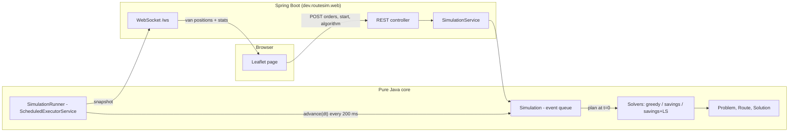

# Delivery Route Simulator

<!-- TODO: demo GIF here (record the Compare view), then the live link -->
**Live demo:** _add your Render URL here_ (free tier sleeps after 15 min idle; the first load can take about a minute)

A dispatch simulator in plain Java 21. Orders are routed onto capacity-limited vans by algorithms written from scratch (no OptaPlanner / Timefold), then replayed as a live discrete-event simulation on a Leaflet map.

> **My optimiser cuts total fleet distance by 15-22% vs a greedy nearest-neighbour baseline on seeded scenarios of 50-500 orders, and lands within 2.0% of the true optimum on 10-order instances solved exactly.**
> CVRPLIB gap: _run the benchmark with the Augerat A files and put the number here_ (see [benchmarks/cvrplib](benchmarks/cvrplib/README.md)).

## Results

### Seeded random scenarios (Haversine km, van capacity 100, parcels 1-10, mean of 5 seeds)

| Orders | Greedy km | Savings km | Savings+LS km | Savings vs greedy | Savings+LS vs greedy | Greedy ms | Savings ms | Savings+LS ms | Vans (greedy / S+LS) |
|---:|---:|---:|---:|---:|---:|---:|---:|---:|---:|
| 50 | 215.9 | 187.5 | 182.8 | -13.2% | -15.4% | 0.9 | 0.5 | 2.2 | 3.2 / 3.4 |
| 100 | 355.9 | 282.4 | 276.4 | -20.7% | -22.3% | 2.0 | 1.5 | 8.9 | 6.0 / 6.4 |
| 200 | 562.4 | 462.1 | 450.9 | -17.8% | -19.8% | 1.3 | 10.6 | 26.8 | 11.4 / 11.6 |
| 500 | 1114.8 | 911.9 | 896.1 | -18.2% | -19.6% | 5.0 | 118.0 | 177.9 | 28.0 / 28.4 |

Distances are straight-line (Haversine) km. Runtimes are from one laptop-class machine, single thread, after JIT warm-up; run it yourself for your own numbers. Local search is capped at 5 s, which none of these runs hit.
The extra van or so that savings+LS sometimes uses is the optimiser trading a van for distance; the solvers don't cap fleet size.

**How close to optimal?** For 10 orders the true optimum can be found exactly (subset DP, in `OptimalityGapTest`). Mean over 30 seeded instances, van capacity 30:

| Greedy | Savings | Savings + local search |
|---:|---:|---:|
| +21.5% above optimum | +3.0% | **+2.0%** |

Reproduce: `mvn test -Dtest=OptimalityGapTest` (prints the line) and `java -cp target/classes dev.routesim.bench.BenchmarkRunner`.

## Run it

```bash
mvn spring-boot:run            # http://localhost:8080
mvn verify                     # all tests
docker build -t route-sim . && docker run -p 8080:8080 route-sim
mvn -q package -DskipTests && java -cp target/classes dev.routesim.bench.BenchmarkRunner
```

In the UI: pick an algorithm, press **Start**, and click the map to add orders while vans are moving. They are inserted live into the cheapest route that can take them. **Compare on this scenario** shows greedy and optimised side by side on the same orders.

## Architecture



Everything under `model/`, `solver/`, `sim/` and `bench/` has no Spring dependency, so it is unit-tested in milliseconds and the benchmark runs without a server.

## What's implemented

- **Greedy baseline** (`NearestNeighbourSolver`): fill one van at a time with the nearest order that still fits.
- **Clarke-Wright savings** (`ClarkeWrightSolver`): start with one van per order; merge routes in order of largest saving `d(0,i) + d(0,j) - d(i,j)` whenever `i` and `j` are route ends and the load fits.
- **Local search** (`LocalSearch`): 2-opt inside a route, relocate (within/between routes), swap between routes, and 2-opt* (exchange route tails). First improvement, capacity-checked, so it can never worsen a solution or break feasibility.
- **Hard rules, tested**: every order delivered exactly once, no van over capacity, every route starts and ends at the depot (`Solution.validate`, plus the same rules spelled out independently in `SolverInvariantsTest`).
- **Reproducible scenarios**: `ScenarioGenerator` is seeded; same seed gives the same orders.
- **CVRPLIB reader**: `CvrplibParser` reads `.vrp` files (EUC_2D, rounded like CVRPLIB) so costs compare directly with published best-known values.
- **Simulation**: a `PriorityQueue` of timed events (`DEPART`, `ARRIVE`), a sim clock with a speed multiplier, run by a `ScheduledExecutorService`.
- **Dynamic orders**: a new order is tried at every legal insertion point of every van and goes where it adds the least distance; if no van can take it, an idle van is woken or a new one dispatched. A van that is heading home is turned around where it is.

## API

| Method | Path | Body | Does |
|---|---|---|---|
| GET | `/api/state` | | snapshot, plan (routes, orders, depot), running flag |
| GET | `/api/compare` | | greedy vs savings+LS on the current orders |
| POST | `/api/scenario/random` | `{"seed":1,"orders":40}` | new seeded random scenario |
| POST | `/api/scenario/clear` | | remove all orders |
| POST | `/api/scenario/depot` | `{"lat":..,"lng":..}` | move the depot (re-plans) |
| POST | `/api/orders` | `{"lat":..,"lng":..,"size":5}` | add an order (live insertion if the clock has started) |
| POST | `/api/sim/start` `/pause` `/reset` | | control the clock |
| POST | `/api/sim/speed` | `{"multiplier":60}` | simulated seconds per real second |
| POST | `/api/algorithm` | `{"name":"greedy"\|"savings"\|"savings+ls"}` | switch algorithm; re-plans the same orders from t=0 |

`/ws` pushes `{snapshot, running, speed}` every 200 ms. When `snapshot.planVersion` changes, the page re-fetches `/api/state` for the new routes.

## Design decisions

**Why Clarke-Wright?** It is the classic constructive heuristic for capacitated routing: simple to explain, O(n^2 log n), deterministic, and typically a few percent from optimal. Starting local search from a good solution is far better than from a random one, and the improvement over the baseline is easy to demonstrate.

**Why these local-search moves?** 2-opt removes crossings within a route; relocate and swap rebalance stops between vans; 2-opt* targets the awkward route tails that merging can leave behind (a design intent; I haven't run an ablation per move). Together they make the result 1.5-2.5% shorter than savings alone in the table above.

**Why event-driven?** Vans spend most of their time driving; nothing happens between "departed" and "arrived". Jumping the clock from event to event is exact (no accumulated tick error), independent of step size (tested: stepping by 1 s or by 20 000 s gives the same result), and cheap. The real-time part is a thin runner that calls `advance(dt)`.

**Why is the simulation decoupled from Spring and the wall clock?** So it is deterministic and testable without sleeping, threads or a server.

**Why a distance matrix?** Solvers do millions of distance lookups; Haversine is computed once per pair.

## Assumptions and limits

- Routes are **straight lines** between stops, not roads. Real road distances would need a routing engine (see next steps).
- One depot, identical vans, no cap on the number of vans, no time windows.
- A live order's parcel is assumed to be handed to a moving van (e.g. by a courier). The capacity rule is still the hard one: all parcels ever assigned to a van must fit.
- Switching algorithm, moving the depot or generating a scenario resets the clock to t=0.
- One shared simulation per server: everyone who opens the page watches the same fleet.
- Map tiles come from the public OpenStreetMap tile server (no key needed), shown in greyscale so the routes stand out. Fine for a demo, but OSM's tile usage policy rules out heavy traffic; switch to a keyed provider if the project gets real use.

## Next steps

- Delivery time windows (VRPTW): feasibility checks on arrival times in every move.
- Real road distances and geometry via OSRM, replacing the Haversine matrix.
- Multiple depots, heterogeneous fleet, driver shifts.
- Stronger metaheuristic (e.g. simulated annealing / ILS) to close the remaining gap.

## Deploy (free tier)

`render.yaml` is a Render Blueprint (`runtime: docker`, `plan: free`). Render's free web service has 512 MB RAM, sleeps after 15 minutes without traffic and takes about a minute to wake; the Dockerfile caps the JVM heap for that reason. Check Render's current pricing page before relying on it.
# Delivery-Route-Simulator

