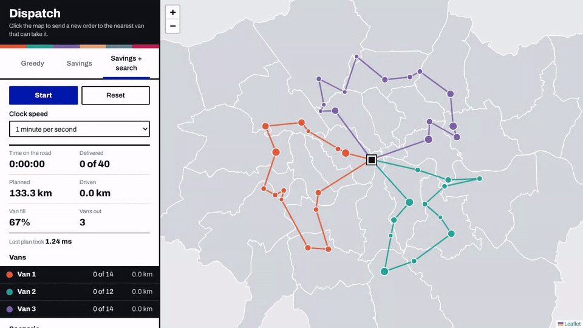

# Delivery Route Simulator

A delivery fleet optimisation and simulation application built with **Java**, Spring Boot, and Leaflet. It uses vehicle routing algorithms implemented from scratch — no OptaPlanner or Timefold — and replays delivery routes as a live, discrete-event simulation on an interactive map.

**Live demo:** 

> **Optimisation results:** Reduces total fleet distance by approximately 15–22% compared with a greedy nearest-neighbour baseline on seeded scenarios containing 50–500 orders. On 10-order instances solved exactly, the savings-plus-local-search algorithm achieves an average optimality gap of just 2.0%.


*Note: The live demo runs on Render's free tier, which may sleep after 15 minutes of inactivity. The first request after sleeping can take around a minute.*

<!-- TODO: Add a demo GIF showing the Compare view. -->

## Results

### Seeded random scenarios

Results use Haversine distances in kilometres, a van capacity of 100, parcel sizes between 1 and 10, and the mean of five random seeds.

| Orders | Greedy (km) | Savings (km) | Savings + LS (km) | Savings vs. Greedy | Savings + LS vs. Greedy | Greedy (ms) | Savings (ms) | Savings + LS (ms) | Vans (Greedy / S+LS) |
|-------:|------------:|-------------:|------------------:|-------------------:|------------------------:|------------:|-------------:|-------------------:|---------------------:|
| 50    | 215.9 | 187.5 | 182.8 | -13.2% | -15.4% | 0.9 | 0.5 | 2.2 | 3.2 / 3.4 |
| 100   | 355.9 | 282.4 | 276.4 | -20.7% | -22.3% | 2.0 | 1.5 | 8.9 | 6.0 / 6.4 |
| 200   | 562.4 | 462.1 | 450.9 | -17.8% | -19.8% | 1.3 | 10.6 | 26.8 | 11.4 / 11.6 |
| 500   | 1114.8 | 911.9 | 896.1 | -18.2% | -19.6% | 5.0 | 118.0 | 177.9 | 28.0 / 28.4 |

**Benchmark notes:**

- Distances are straight-line Haversine distances, not road distances.
- Runtimes were measured on a laptop-class machine, using a single thread after JIT warm-up. Results may vary by hardware and JVM.
- Local search has a five-second time limit, which none of these runs reached.
- Savings-based algorithms may use an additional van to reduce total distance. Fleet size is not capped.

### How close to optimal?

For instances containing 10 orders, the true optimum can be calculated exactly using subset dynamic programming, implemented in `OptimalityGapTest`.

Results are averaged over 30 seeded instances with a van capacity of 30.

| Algorithm | Average distance above optimum |
|-----------|-------------------------------:|
| Greedy | +21.5% |
| Clarke–Wright Savings | +3.0% |
| Savings + Local Search | **+2.0%** |

Reproduce these results locally:

```bash
mvn test -Dtest=OptimalityGapTest
java -cp target/classes dev.routesim.bench.BenchmarkRunner
```

The test prints the optimality-gap results. Run the benchmark runner separately to evaluate larger scenarios.

## Features

- **Multiple routing algorithms:** Compare greedy nearest-neighbour, Clarke–Wright savings, and savings with local search.
- **Interactive fleet simulation:** Watch vans travel between stops on a Leaflet map.
- **Live order insertion:** Click the map to add orders while the simulation is running.
- **Route comparison:** Compare greedy and optimised solutions on the same scenario.
- **Capacity constraints:** Every route respects the configured van capacity.
- **Reproducible benchmarks:** Generate deterministic scenarios using random seeds.
- **Exact optimality evaluation:** Compare heuristic solutions against an exact solver on small instances.
- **CVRPLIB support:** Parse benchmark instances in `.vrp` format for comparison with published best-known solutions.

## Getting Started

### Prerequisites

- Java 21 or later
- Maven
- Docker (optional)

### Run locally

Start the Spring Boot application:

```bash
mvn spring-boot:run
```

Open [http://localhost:8080](http://localhost:8080) in your browser.

